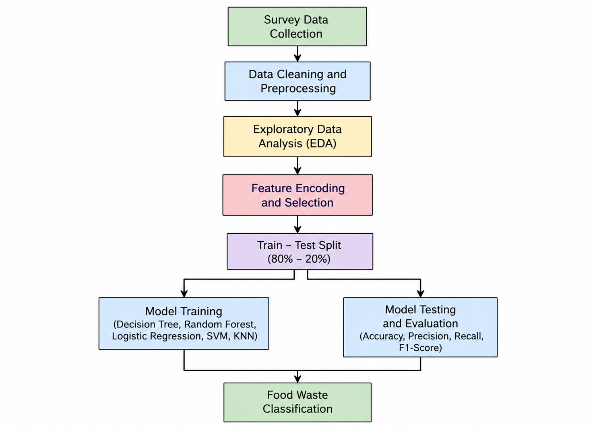
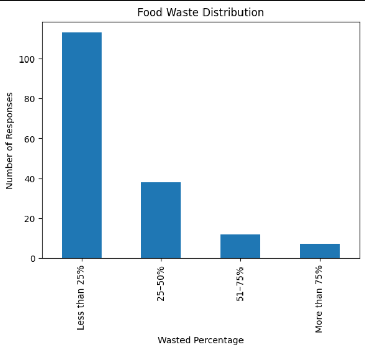
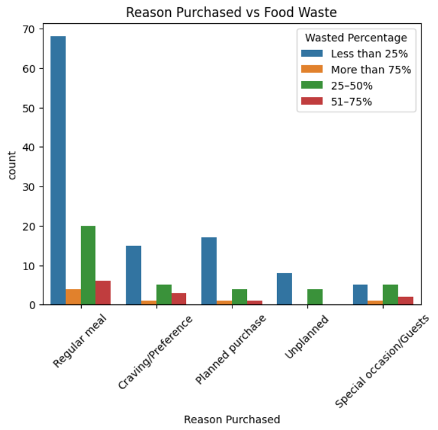
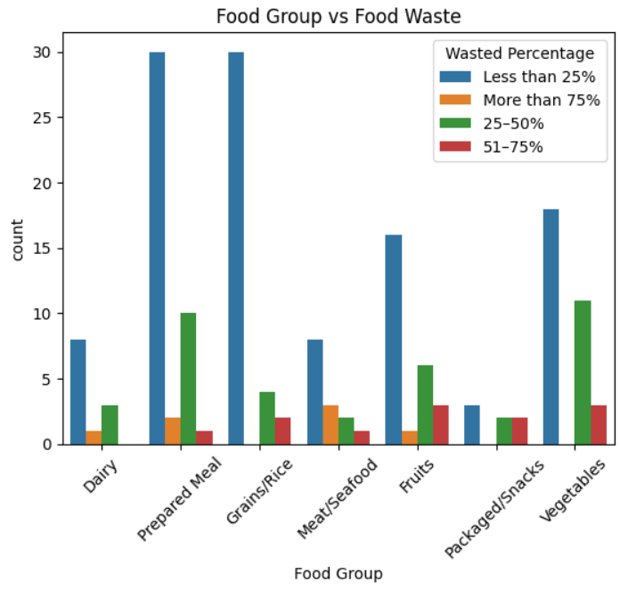
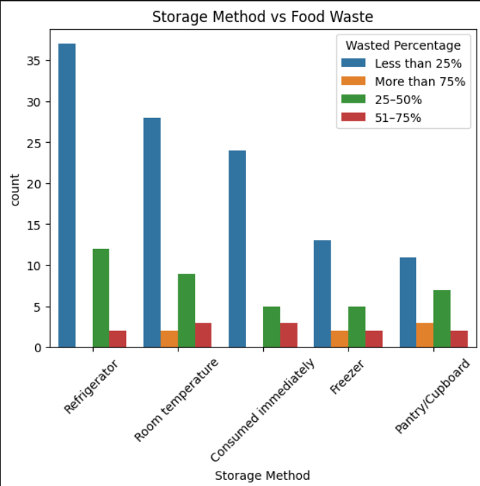
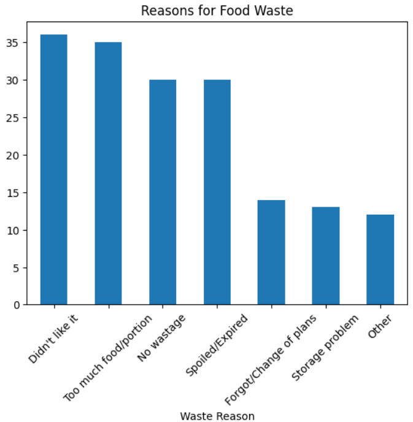
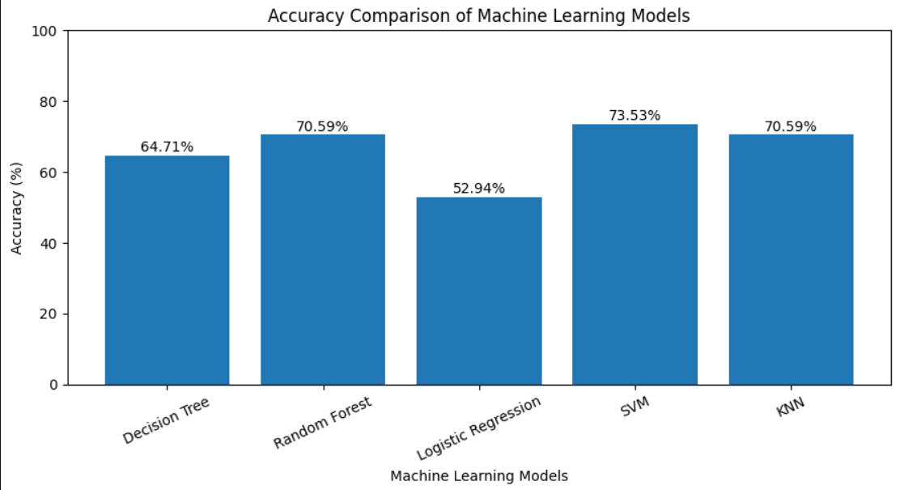
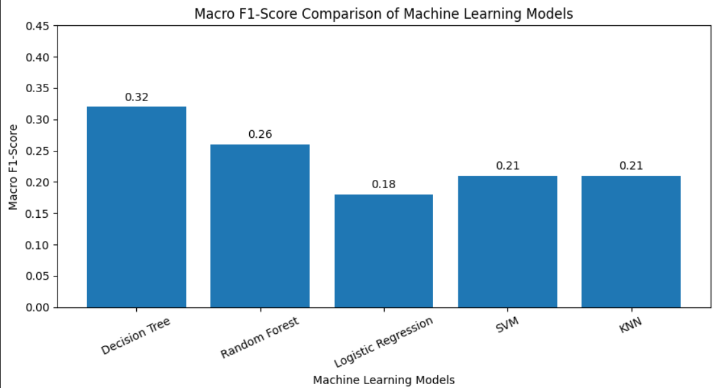

# 🍽️ Household Food Waste Prediction Using Machine Learning

<p align="center">
  <b>Analyzing Household Food Waste Patterns Using Machine Learning Classification Algorithms</b>
</p>

<p align="center">
  
  
  
  
</p>

---

## 📌 About the Project

Household food waste is a significant issue that affects food sustainability, household expenses, and resource utilization.

This project focuses on analyzing household food waste patterns using machine learning classification algorithms. Primary survey data is used to understand how food purchasing habits, food groups, storage methods, and household practices are associated with food wastage.

The project includes data preprocessing, exploratory data analysis (EDA), implementation of multiple machine learning models, and performance evaluation.

The main objective is to compare different classification algorithms and understand their effectiveness in classifying household food waste levels.

## 🎯 Objectives

- Analyze household food waste patterns using primary survey data.
- Understand factors associated with household food wastage.
- Perform data cleaning and preprocessing.
- Conduct Exploratory Data Analysis (EDA).
- Identify patterns across food groups and storage methods.
- Implement multiple machine learning classification algorithms.
- Compare model performance using different evaluation metrics.

---

## 📂 Dataset Description

The dataset was collected through a primary household survey.

| Attribute | Description |
|---|---|
| Data Source | Primary Survey |
| Total Records | 170 unique food-level records |
| Total Features | 16 |
| Problem Type | Multi-class Classification |
| Target Variable | Wasted Percentage |

### Target Variable Distribution

The target variable `Wasted Percentage` is divided into four categories.

| Food Waste Category | Records | Percentage |
|---|---:|---:|
| Less than 25% | 113 | 66.47% |
| 25–50% | 38 | 22.35% |
| 51–75% | 12 | 7.06% |
| More than 75% | 7 | 4.12% |

The dataset has an imbalanced class distribution, with most records belonging to the less-than-25% category.

---

## 🛠️ Technologies Used

| Technology | Purpose |
|---|---|
| Python | Programming language |
| Pandas | Data manipulation and analysis |
| NumPy | Numerical operations |
| Matplotlib | Data visualization |
| Seaborn | Statistical visualization |
| Scikit-learn | Machine learning and evaluation |
| Spyder | Python development environment |

---

## ⚙️ Project Workflow

The project follows these major stages:

1. Data Collection
2. Data Inspection
3. Data Cleaning and Preprocessing
4. Exploratory Data Analysis
5. Feature Selection and Encoding
6. Train-Test Split (80:20)
7. Model Training
8. Model Evaluation and Comparison

### Workflow Diagram



---

## 📊 Exploratory Data Analysis (EDA)

Exploratory Data Analysis was performed to understand the dataset and identify patterns associated with household food wastage.

### 1. Target Variable Distribution



### 2. Purchase Reason vs Food Waste



### 3. Food Group vs Food Waste



### 4. Storage Method vs Food Waste



### 5. Reasons for Food Waste



---
## 📊 Descriptive Statistical Analysis

Descriptive statistical analysis was performed to understand the numerical characteristics of the household food waste dataset.

The following statistical measures were calculated using Pandas:

- **Mean:** Calculates the average value.
- **Median:** Identifies the middle value.
- **Mode:** Finds the most frequently occurring value.
- **Standard Deviation:** Measures the spread of data.
- **Minimum:** Identifies the smallest value.
- **Maximum:** Identifies the largest value.

This analysis provides a statistical summary of the dataset and helps understand the distribution of numerical attributes.
---

## 🤖 Machine Learning Models

Five classification algorithms were implemented to classify household food waste levels.

### 1. Decision Tree Classifier
Uses decision rules to divide observations into different classes.

### 2. Random Forest Classifier
Combines multiple decision trees to improve classification predictions.

### 3. Logistic Regression
Estimates the probability of an observation belonging to different classes.

### 4. Support Vector Machine (SVM)
Identifies decision boundaries to separate different classes.

### 5. K-Nearest Neighbors (KNN)
Classifies observations based on their nearest neighboring data points.

---

## 📈 Model Evaluation

The models were evaluated using the following metrics:

| Metric | Description |
|---|---|
| Accuracy | Proportion of correctly classified observations |
| Macro Precision | Average precision across all classes |
| Macro Recall | Average recall across all classes |
| Macro F1-Score | Average F1-score across all classes |

Macro-averaged metrics are useful because the target classes have unequal numbers of records.

### Model Accuracy Comparison



### Macro F1-Score Comparison



---

## 🔍 Key Observations

- Most records belong to the less-than-25% food waste category.
- The target variable has an imbalanced class distribution.
- EDA helps explore relationships between household practices and food wastage.
- Five machine learning classification algorithms were implemented.
- Multiple evaluation metrics were used to compare model performance.

---

## 📁 Repository Structure

```text
household-food-waste-prediction/
│
├── Food_Waste_Prediction/
│   │
│   ├── images/
│   │   ├── target_distribution.png
│   │   ├── purchase_reason.png
│   │   ├── food_group_analysis.png
│   │   ├── storage_analysis.png
│   │   ├── waste_reasons.png
│   │   ├── accuracy_comparison.png
│   │   ├── f1_score_comparison.png
│   │   └── workflow_diagram.png
│   │
│   ├── Data.xls
│   ├── INT234.py
│   └── research_paper.pdf
│
└── README.md

```

---

## 🚀 How to Run the Project

### Prerequisites

- Python 3.x
- Spyder, VS Code, or Jupyter Notebook

### 1. Clone the Repository

```bash
git clone https://github.com/kummetha-manaswi/household-food-waste-prediction.git
```

### 2. Navigate to the Project Directory

```bash
cd household-food-waste-prediction
```

### 3. Install Required Libraries

```bash
pip install pandas numpy matplotlib seaborn scikit-learn xlrd
```

### 4. Open the Python File

Open `INT234.py` using Spyder or your preferred Python IDE.

### 5. Configure the Dataset Path

Ensure that the dataset path in the Python script points to the correct location of `Data.xls`.

### 6. Run the Program

Execute the Python script to perform data preprocessing, exploratory data analysis, model training, and evaluation.

---

## ⚠️ Limitations

- The project uses primary survey data with a relatively small number of records.
- The target variable has an imbalanced class distribution.
- Model performance may vary depending on the training and testing split.
- Findings are based on the collected survey data.

---

## 🔮 Future Enhancements

- Develop a web-based food waste prediction system that helps households estimate potential food waste in advance.
- Provide early warnings and recommendations based on food purchasing habits, storage methods, household size, and consumption patterns.
- Build an interactive dashboard to visualize food consumption, waste patterns, and prediction results.
- Suggest better food purchasing quantities and portion sizes to minimize unnecessary waste.
- Implement personalized recommendations to improve food storage and leftover management.
- Deploy the trained machine learning model as a web application for real-time predictions.

---

## 👩‍💻 Author

**Kummetha Manaswi**

B.Tech - Computer Science and Engineering  
Lovely Professional University

---

## 📄 Project Information

| Category | Details |
|---|---|
| Project Title | Household Food Waste Prediction Using Machine Learning |
| Domain | Data Science and Machine Learning |
| Programming Language | Python |
| Learning Type | Supervised Learning |
| Problem Type | Multi-class Classification |
| Dataset | Primary Survey Data |

---

<p align="center">
  Interested in this project or have questions? Let's connect, share ideas, and explore opportunities for collaboration.
</p>
